<div align="center">
  <a href="https://zhsaikot.github.io/calculator-hub/">
    
  </a>

  <br /><br />

  <h1>🧮 CalcHub — Precision Online Calculator Hub</h1>

  <p>
    <strong>A fast, minimalist, 100% client-side suite of 18 specialized calculators</strong><br />
    covering Everyday Math, Global Finance, and dedicated <strong>Bangladesh Utility Tools</strong>.
  </p>

  <p>
    <a href="https://zhsaikot.github.io/calculator-hub/">
      
    </a>
    <a href="https://github.com/zhsaikot/calculator-hub/actions">
      
    </a>
    <a href="https://opensource.org/licenses/MIT">
      
    </a>
  </p>

  <p>
    
    
    
    
    
  </p>

  <p>
    <a href="https://zhsaikot.github.io/calculator-hub/">🚀 Launch Live App</a> •
    <a href="#-bangladeshi-special-tools-7-tools">🇧🇩 Bangladeshi Tools</a> •
    <a href="#-key-ux-highlights">✨ Features</a> •
    <a href="#-architecture">🛠️ Architecture</a> •
    <a href="#-local-development">💻 Run Locally</a>
  </p>
</div>

---

## ✨ Key UX Highlights

| Feature | Description |
| :--- | :--- |
| 📜 **Live History & Tape Panel** | Side-by-side live calculation tape on Basic Calculator with **inline editing**, **custom notes**, **1-click reuse**, **share/copy**, and **`.TXT` file download**. |
| 📌 **Fixed Collapsible Sidebar** | Permanently pinned left navigation with **3 collapsible accordion categories** (`Basic`, `International`, `Bangladeshi`) and a bottom collapse toggle switch. |
| ⚡ **100% Private & Client-Side** | Zero tracking, zero ads, zero server calls. All math runs locally in your browser with strict floating-point precision correction. |
| 🔍 **Command Palette (`Ctrl + K`)** | Instant fuzzy search across English and **বাংলা (Bengali)** keywords (e.g., `gpa`, `বিকাশ`, `জমি`, `payscale`). |
| 🔗 **Deep-Linking & Sharing** | Share pre-filled calculator links directly via URL hash routing (e.g., `#/loan-emi?amt=500000&rate=8.5&term=5`). |
| 🌓 **Minimalist Dark & Light Theme** | Crisp, distraction-free UI designed with Inter typography and persistent theme preference. |
| 📱 **Installable PWA** | Works offline and installs natively on Desktop, Android, and iOS. |

---

## 🧰 Complete Tools Directory (18 Calculators)

### 1. 🧮 Basic Calculators (4 Tools)
| Tool | Key Capabilities |
| :--- | :--- |
| **Basic Calculator** | Everyday arithmetic (`+`, `−`, `×`, `÷`, `%`, `+/−`), keyboard shortcuts, IEEE-754 float precision, and **Side-by-Side Live History** (Edit, Note, Share, `.TXT` Export). |
| **Scientific Calculator** | Trigonometry (`sin`, `cos`, `tan`) with `DEG/RAD` toggle, logarithms (`log`, `ln`), powers, roots, factorials, and constants (`π`, `e`). |
| **Age Calculator** | Exact age breakdown in years, months, days, total hours, and live next-birthday countdown. |
| **Percentage Calculator** | 6 instant percentage modes including % of number, % change, increase/decrease, and reverse percentage. |

---

### 2. 🌐 International & Financial Tools (7 Tools)
| Tool | Key Capabilities |
| :--- | :--- |
| **Loan / EMI Calculator** | Monthly EMI, total interest payable, full amortization schedule table, and **CSV Export**. |
| **Compound Interest** | Investment future value forecasting with customizable compounding frequencies and recurring deposits. |
| **Global Tax Calculator** | Multi-currency net salary, take-home pay, and effective tax rate estimator. |
| **Profit & Loss Calculator** | Business margin analysis, COGS, revenue breakdown, gross profit, and markup %. |
| **Discount & Sale Calculator** | Shopping markdowns, stacked discounts, sales tax calculation, and total net savings. |
| **BMI Calculator** | Visual Body Mass Index gauge meter with WHO health categories and ideal weight range. |
| **All-in-One Unit Converter** | Instant conversion across Length, Weight, Temperature, Area, and Speed. |

---

### 3. 🇧🇩 Bangladeshi Special Tools (7 Tools)
Tailored specifically for Bangladesh's education, government payroll, mobile banking, taxation, land measurement, savings, and jewelry standards:

| Tool | Key Capabilities |
| :--- | :--- |
| 🎓 **SSC & HSC GPA Calculator** | Official BD Education Board formula: **4th subject bonus** (`points > 2.00`), compulsory subject fail check, Science/Commerce/Arts presets, and **Golden A+** detector. |
| 💼 **Govt Pay Scale & Pension** | Complete **Grades 1–20** salary breakdown, location-based house rent (Dhaka, City Corp, District, Upazila), medical, education allowance, GPF deduction, and **25-year pension/gratuity** estimator. |
| 📱 **bKash / Nagad / Rocket / Upay Comparator** | Side-by-side cash-out fee comparison across 4 wallets (Priyo, App, USSD), Best Value badge, and **Reverse Send Mode** (*"প্রাপক পুরো টাকা পেতে কত পাঠাতে হবে?"*). |
| 📍 **Land Measurement (জমি পরিমাপ)** | Instant converter for **Shotok (শতক), Katha (কাঠা), Bigha (বিঘা), Acre (একর), Sq Feet**, plus **4-side quadrilateral boundary survey** (Average & Heron's diagonal method). |
| 📊 **BD Income Tax (NBR Rules)** | NBR progressive tax slabs (`5%–25%`), category exemptions (General `৳3.5L`, Female/Senior `৳4L`, Disabled `৳4.75L`, Freedom Fighter `৳5L`), investment tax rebate, and city corporation minimum tax. |
| 🛡️ **Sanchayapatra Profit (সঞ্চয়পত্র)** | Paribar, 3-Month Profit, Pensioner, and 5-Year BD schemes with `৳15L` / `৳30L` slab rates and **5% / 10% Source Tax (TDS)** net payout calculation. |
| ✨ **Gold & Silver Price (স্বর্ণের দাম)** | **Vori–Ana–Roti–Gram** converter (`1 Vori = 16 Ana = 96 Roti = 11.664g`), BAJUS purity rates (`22K`, `21K`, `18K`, `Traditional`), making charge, and **5% Govt VAT**. |

---

## 🛠️ Architecture

```text
calculator-hub/
├── assets/
│   └── banner.svg                 # Animated vector hero banner for README
├── docs/                          # Production build synced for GitHub Pages
├── public/                        # PWA manifest, icons, sitemap.xml, robots.txt
├── src/
│   ├── components/
│   │   ├── calculators/           # Basic, Scientific, Financial & Health UIs
│   │   │   └── bd/                # 7 dedicated Bangladesh calculator UIs
│   │   ├── common/                # CalculatorWrapper, CalculatorLiveHistory, BdFlagIcon, SEO, Modals
│   │   ├── home/                  # HomeHub hero, search, and category filter grid
│   │   └── layout/                # Fixed Header, Collapsible Accordion Sidebar, Footer
│   ├── context/                   # ThemeContext & HistoryContext (localStorage persisted)
│   ├── hooks/                     # useHashRoute for deep-linking
│   ├── lib/calculators/           # Pure, framework-agnostic TypeScript math engines
│   │   └── bd/                    # 7 pure BD calculation modules
│   ├── App.tsx
│   ├── main.tsx
│   └── index.css
├── tests/
│   ├── calculators.test.ts        # 19 core engine unit tests
│   └── bd-calculators.test.ts     # 13 Bangladesh engine unit tests
├── package.json
├── tailwind.config.js
└── vite.config.ts
```

---

## 🧪 Testing & Quality Assurance

All calculation engines are decoupled from React UI components and verified with **32 automated unit tests** via Vitest:

```bash
# Run TypeScript type check
npm run typecheck

# Run full unit test suite (32/32 tests)
npm test

# Run tests in watch mode
npm run test:watch
```

---

## 💻 Local Development

```bash
# 1. Clone the repository
git clone https://github.com/zhsaikot/calculator-hub.git
cd calculator-hub

# 2. Install dependencies
npm install

# 3. Start development server
npm run dev

# 4. Type-check, build production bundle & sync docs/
npm run typecheck && npm run build
```

---

## 🚢 Deployment

CalcHub is configured for zero-effort deployment on **GitHub Pages**:
- Running `npm run build` compiles the Vite production bundle into `dist/` and automatically syncs it to `docs/`.
- GitHub Actions workflow (`.github/workflows/deploy.yml`) also validates builds on push to `main`.

---

## 👨‍💻 Author & License

<div align="center">
  <p>
    Developed with precision by <a href="https://mdziaulhasan.com/"><strong>Md Ziaul Hasan</strong></a>
  </p>
  <p>
    Distributed under the <a href="LICENSE">MIT License</a>.
  </p>
</div>
